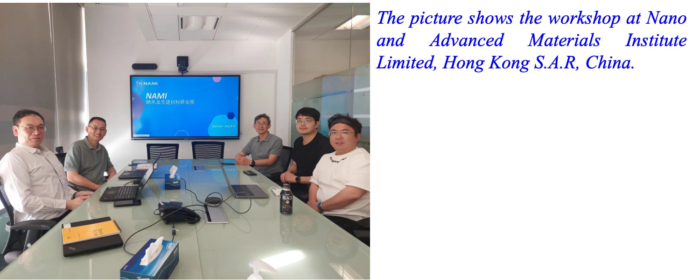

<!--more-->

As a Steering Committee member for the Southern Advanced Photon Source (SAPS), Prof. Ren actively contributed to the future planning of this major synchrotron facility. He organized and participated in several workshops and meetings held at the end of 2023 and early 2024. SAPS represents an important future synchrotron radiation facility in southern China, and Prof. Ren's involvement reflects his role in advocating for the establishment of a consortium for synchrotron-based frontier research amongst local universities and organizations, aligning with one of the key objectives of his Global STEM Professorship.

