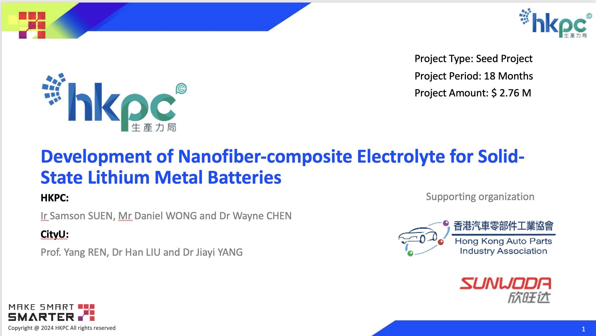

<!--more-->

Prof. Ren led his research group in collaboration with the Hong Kong Productivity Council (HKPC) to apply for the Innovation and Technology Support Programme (Seed) in June 2024. This industry collaboration project was submitted and was under review at the time of the report. The partnership with HKPC, a statutory body promoting productivity in Hong Kong, exemplifies Prof. Ren's effort to bridge synchrotron-based research with industry applications and to translate fundamental materials science discoveries into practical outcomes that benefit Hong Kong's industrial sector.

The lab led a research group in collaboration with the Hong Kong Productivity Council (HKPC) to apply for the Innovation and Technology Support Programme (Seed) in June 2024, focusing on the 'Development of Nanofiber-Composite Electrolyte for Solid-State Lithium Metal Batteries.' As part of the application process, the team conducted an on-site visit to HKPC, engaging in in-depth discussions on advancing technologies related to solid-state lithium-ion batteries. These exchanges explored potential synergies and collaborative opportunities to drive innovation and development in this cutting-edge field.
