<!--more-->

<!--more-->

The Hong Kong Forum on Neutron Scattering is a conference series that focuses on specific aspects of neutron scattering science and their applications. The **2026 Forum** will feature **energy materials and applications**, particularly in relation to scientific research, instrument development and industrial applications.

Sponsored by the **Center for Neutron Scattering at City University of Hong Kong (CityUHK)**, the forum will bring together researchers from academia and industry, along with specialists from major international neutron scattering facilities, to discuss the latest developments in neutron scattering (including synchrotron) and its applications to energy materials such as batteries, fuel cells, hydrogen storage, energy conversion materials and nuclear energy. Participants will share recent findings and exchange views on current challenges in the field.

Additionally, the forum will provide opportunities for students and early-career scientists in Hong Kong and the surrounding area to learn the fundamentals and applications of neutron scattering.

## Forum Details

- **Dates:** 7–11 December 2026 (Day 0 check-in and welcome dinner on 7 December; scientific sessions 8–10 December; optional CSNS tour on 11 December)
- **Hosts:** Prof. Ren Yang and Prof. Yin Wen, City University of Hong Kong
- **Venue:** Eminence Galaxy, Room 11-231, LAU, City University of Hong Kong
- **Format:** In-person conference
- **Language:** English
- **Focus:** Energy Materials & Applications
- **Registration:** Free of charge

[Download the poster (PDF, A0)](poster.pdf)



## Focus Areas

- **Batteries** — electrode materials, electrolytes, degradation and operando studies
- **Fuel Cells** — catalysts, membranes and ion-transport phenomena
- **Hydrogen Storage** — sorption materials, sorbents and hydrogen infrastructure
- **Energy Conversion Materials** — thermoelectrics, catalysts and multifunctional converters
- **Nuclear Energy** — radiation response, structural materials and reactor components
- **Instrument Development** — new neutron and synchrotron techniques for energy materials
- **Data Analysis & Complementary Techniques** — reduction, modelling and in-situ correlation

## Invited Speakers

**Prof. Frank Gabel** — *Institut Laue-Langevin (ILL), France*

[Profile](https://www.ill.eu/for-ill-users/scientific-groups/biology-deuteration-chemistry-and-soft-matter-support/people/frank-gabel)

**Dr. Peter Falus** — *Institut Laue-Langevin (ILL), France*

 [Profile](https://www.ill.eu/for-ill-users/scientific-groups/spectroscopy/people/peter-falus)

**Prof. Jian Ren Lu** — *The University of Manchester, United Kingdom*

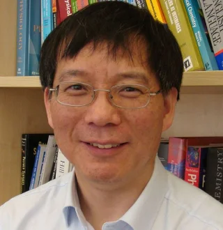 [Profile](https://research.manchester.ac.uk/en/persons/j.lu)

**Dr. Mona Sarter** — *ISIS Neutron and Muon Source, United Kingdom*

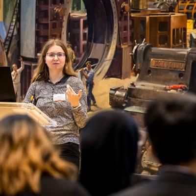 [Profile](https://www.isis.stfc.ac.uk/Pages/SH25_Mona-Sarter.aspx)

**Dr. Peixun Li** — *ISIS Neutron and Muon Source, United Kingdom*

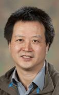 [Profile](https://www.isis.stfc.ac.uk/Pages/Dr-Peixun-Li.aspx)

**Prof. Sung-Min Choi** — *Korea Advanced Institute of Science and Technology (KAIST), Korea*

[Profile](https://pure.kaist.ac.kr/en/persons/sung-min-choi)

**Prof. Hideki Seto** — *J-PARC / CROSS, Japan*

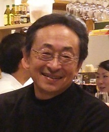 [Profile](https://research.kek.jp/people/seto/profile.html)

**Prof. Koichi Mayumi** — *University of Tokyo, Japan*

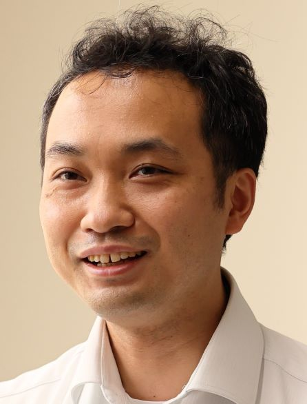 [Profile](https://www.k.u-tokyo.ac.jp/materials/en/mayumi/)

**Prof. Tatsuro Oda** — *University of Tokyo, Japan*

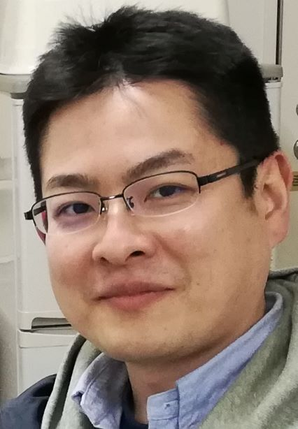 [Profile](https://www.u-tokyo.ac.jp/focus/en/people/k0001_04078.html)

**Prof. Takeshi Yamada** — *J-PARC / CROSS, Japan*

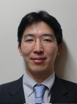 [Profile](https://www.scl.kyoto-u.ac.jp/~kanaya2/yamada.html)

**Prof. Limei Xu** — *Peking University, China*

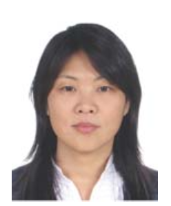 [Profile](https://faculty.pku.edu.cn/~niQ7Vj/en/index.htm)

**Dr. Hongyu Guo** — *China Spallation Neutron Source (CSNS), China*

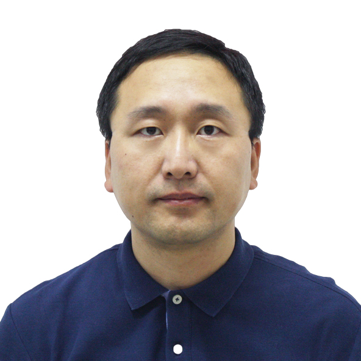 [Profile](https://people.ucas.ac.cn/~GUO?language=en)

**Prof. He Cheng** — *China Spallation Neutron Source (CSNS), China*

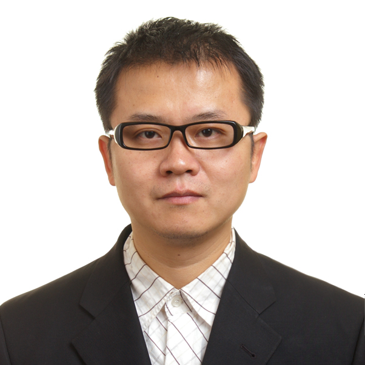 [Profile](https://people.ucas.edu.cn/~chenghe?language=en)

**Prof. Yubin Ke** — *China Spallation Neutron Source (CSNS), China*

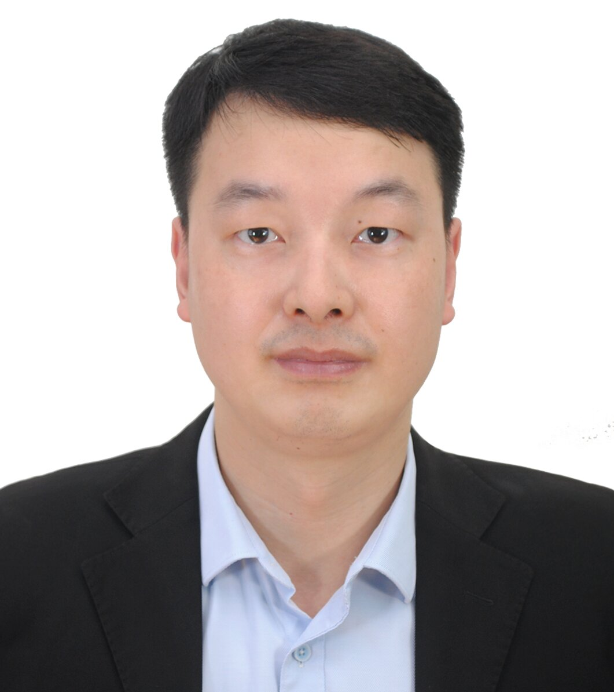 [Profile](https://people.ucas.ac.cn/~yubinke)

**Prof. George Sawatzky** — *The University of British Columbia, Canada*

[Profile](https://phas.ubc.ca/users/george-sawatzky)

**Dr. Taisen Zuo** — *China Spallation Neutron Source (CSNS), China*

[Profile](https://people.ucas.edu.cn/~zuotaisen.ucas.edu.cn)

**Dr. Hanqiu Jiang** — *China Spallation Neutron Source (CSNS), China*

[Profile](https://people.ucas.ac.cn/~jianghanqiu)

**Prof. Xiaocheng Zeng** — *City University of Hong Kong*

[Profile](https://www.cityu.edu.hk/mse/people/mse-faculty/zeng-xiaocheng)

## Program

Talk titles and speakers will be listed here once confirmed.

### Day 0 — Monday, 7 December 2026 (Arrival)

| Time | Event |
| --- | --- |
| All day | Registration and check-in |
| 18:30 – 20:00 | Welcome dinner |

### Day 1 — Tuesday, 8 December 2026

| Time | Event |
| --- | --- |
| 09:00 – 09:15 | Opening remarks |
| 09:15 – 09:30 | Welcome remarks |
| 09:30 – 10:00 | Talk 1 |
| 10:00 – 10:30 | Break and group photo |
| 10:30 – 11:00 | Talk 2 |
| 11:00 – 11:30 | Talk 3 |
| 11:30 – 12:00 | Talk 4 |
| 12:00 – 14:00 | Lunch at campus |
| 14:00 – 14:30 | Talk 5 |
| 14:30 – 15:00 | Talk 6 |
| 15:00 – 15:30 | Talk 7 |
| 15:30 – 16:00 | Break |
| 16:00 – 16:30 | Talk 8 |
| 16:30 – 17:00 | Talk 9 |
| 17:00 – 17:30 | Talk 10 |
| 17:30 – 20:00 | Dinner (off campus, invited participants only) |

### Day 2 — Wednesday, 9 December 2026

| Time | Event |
| --- | --- |
| 10:00 – 10:30 | Talk 11 |
| 10:30 – 10:45 | Break |
| 10:45 – 11:15 | Talk 12 |
| 11:15 – 11:45 | Talk 13 |
| 11:45 – 12:15 | Talk 14 |
| 12:15 – 13:45 | Lunch at campus |
| 13:45 – 20:30 | Lamma Island (南丫島) excursion and seafood dinner |

### Day 3 — Thursday, 10 December 2026

| Time | Event |
| --- | --- |
| 10:00 – 10:30 | Talk 15 |
| 10:30 – 10:45 | Break |
| 10:45 – 11:15 | Talk 16 |
| 11:15 – 11:45 | Talk 17 |
| 11:45 – 12:15 | Talk 18 |
| 12:15 – 14:00 | Lunch at campus |
| 14:00 – 15:30 | Lab tour |
| 15:30 – 16:00 | Break |
| 16:00 – 17:30 | Discussion |

### Day 4 — Friday, 11 December 2026 (Optional)

| Time | Event |
| --- | --- |
| To be confirmed | Optional tour to the China Spallation Neutron Source (CSNS), Dongguan |

## Practical Information

### Meals

| Meal | When | Where |
| --- | --- | --- |
| Meal 1 | Lunch, 8 December | On campus |
| Meal 2 | Dinner, 8 December | Off campus — invited participants only |
| Meal 3 | Lunch, 9 December | On campus |
| Meal 4 | Seafood dinner, 9 December | Lamma Island — invited participants only |
| Meal 5 | Lunch, 10 December | On campus |

### Transport

- **8 December, 17:30** — coach departs CityUHK, 83 Tat Chee Avenue (outside the "四不像" sculpture), for the dinner venue.
- **9 December, 13:45** — coach departs CityUHK, 83 Tat Chee Avenue (outside the "四不像" sculpture), for Tsim Sha Tsui Public Pier and onward to Lamma Island.

### Wi-Fi

- **Wi-Fi.HK via CityU** — free basic access on campus.
- **eduroam** — connect with your institutional account.

## Forum Registration

Please scan the QR code below to complete the Tencent Docs information form. **Registration is free of charge.**

If you cannot scan the code, please fill in the form via the link: [Tencent Docs — Information Collection Form](https://docs.qq.com/form/page/DQWVabUVzbVdFbGhF).

## Host and Sponsors

**Host:** Prof. Ren Yang and Prof. Yin Wen, City University of Hong Kong.

**Sponsored by the [Center for Neutron Scattering at CityUHK](https://www.cityu.edu.hk/cns).**

## Contact

**Center for Neutron Scattering**

City University of Hong Kong

Tat Chee Avenue, Kowloon, Hong Kong

Email: [syxiao5-c@my.cityu.edu.hk](mailto:syxiao5-c@my.cityu.edu.hk)

### Quick Links

- [City University of Hong Kong](https://www.cityu.edu.hk)

- [Department of Physics, CityUHK](https://www.cityu.edu.hk/phy)

- [Centre for Neutron Scattering, CityUHK](https://www.cityu.edu.hk/cns)

- [UGC / RGC](https://www.ugc.edu.hk/eng/rgc/)

- [Campus Map of CityUHK](https://www.cityu.edu.hk/en/about/campus/map)

- [Getting to CityU](https://www.cityu.edu.hk/en/about/campus/getting-to-cityu)
