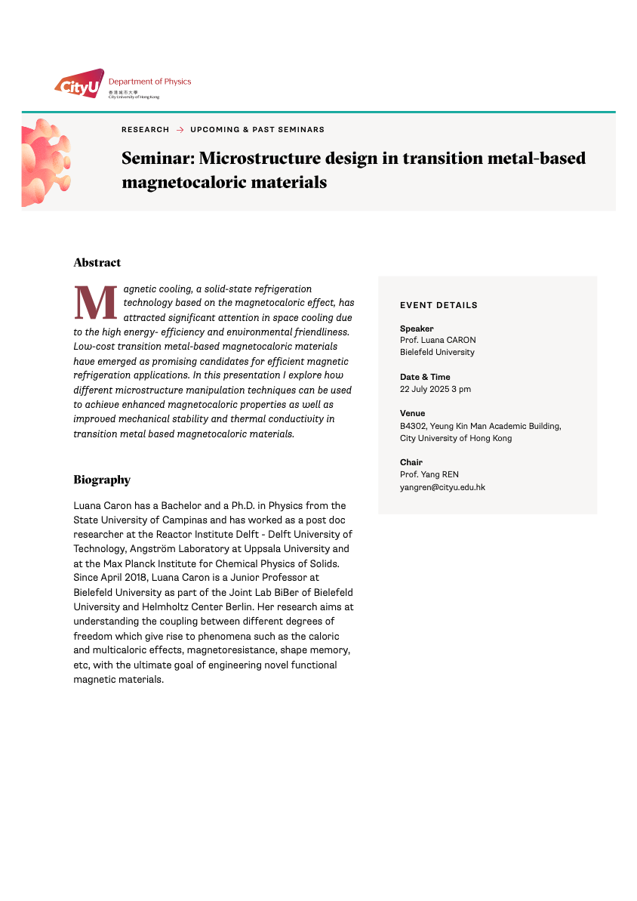

<!--more-->

To advance frontier research on functional magnetic materials and promote international academic exchange, Prof. Ren hosted Prof. Luana Caron, Junior Professor at Bielefeld University and member of the Joint Lab BiBer of Bielefeld University and Helmholtz Center Berlin, for a seminar titled "Microstructure Design in Transition Metal-Based Magnetocaloric Materials." The event was held on 22 July 2025 at City University of Hong Kong. Prof. Caron presented innovative strategies for manipulating microstructures to enhance magnetocaloric properties, mechanical stability, and thermal conductivity in transition metal-based materials. Her presentation stimulated in-depth discussions with faculty members and students, inspiring new ideas for sustainable solid-state refrigeration technologies.

