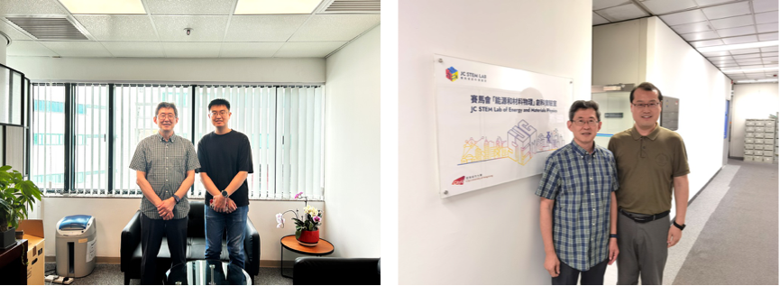

<!--more-->

During their research attachments, Mr. Zhang Jingxi and other PhD students visited and conducted experiments at CSNS (China Spallation Neutron Source), performing advanced synchrotron-based characterization measurements including in-situ diffraction and X-ray absorption spectroscopy on cathode materials for lithium-ion batteries. The visit provided valuable hands-on experience with frontier neutron and synchrotron research facilities. Additionally, the students visited a battery manufacturer to gain industry perspective on practical applications of their cathode materials research, bridging academic studies with industrial relevance.

