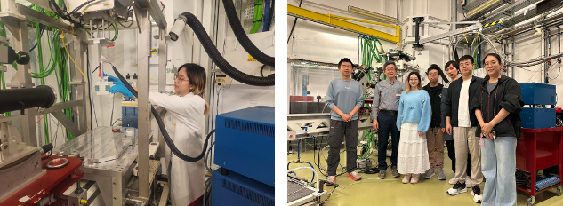

<!--more-->

Prof. Yang REN led local undergraduate students Ms. YEUNG Yeuk Yee and Mr. REN Yanhao, together with Ph.D. students, to conduct in-situ synchrotron X-ray absorption spectroscopy experiments at the SOLEIL Synchrotron in France. The experiment focused on tracking the structural and electronic changes of high-nickel ternary cathode materials during electrochemical cycling. YEUNG Yeuk Yee and REN Yanhao, undergraduates at CityUHK, participated in the research project and engaged in the entire process, including sample preparation, in-situ cell assembly, beamline operation and data analysis. Through direct participation in this work, the local students gained hands-on experience in synchrotron X-ray science and advanced battery materials research, strengthening their practical research skills, scientific confidence, and understanding of energy materials physics.

