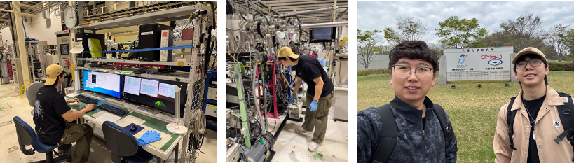

<!--more-->

LEUNG Chi Hon, a local Ph.D. student, conducted synchrotron soft X-ray absorption spectroscopy experiments at the SPring-8 facility in Japan together with a postdoctoral researcher from Prof. REN's group. The experiments focused on Li-rich cathode materials and solid-state electrolytes, aiming to understand their electronic and structural evolution and the fundamental charge transfer behaviours of Li-rich cathode materials using advanced synchrotron techniques. Through this hands-on beamline experience, Mr. Leung gained practical training in synchrotron experiment preparation, data collection and preliminary analysis, further enhancing the research capability of local young scientists and contributing to the JC STEM Lab's objective of nurturing local talent in energy and materials physics.

