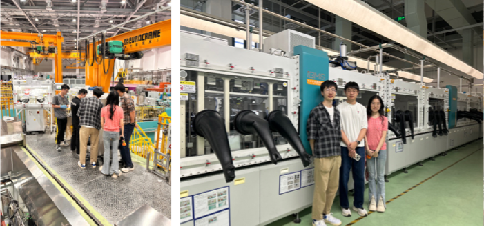

<!--more-->

To foster international collaboration and cultivate high-level research talent, Prof. Ren has consistently supported visiting scholars from leading academic and research institutions. Mr. Zhang Jingxi, a Ph.D. candidate from Tsinghua University, joined the group from November 2024 to May 2025. During this six-month research attachment, Mr. Zhang carried out in-depth investigations on Li- and Mn-rich cathode materials for advanced lithium-ion batteries. Under Prof. Ren's guidance, he acquired extensive hands-on experience with state-of-the-art synchrotron-based techniques, including X-ray absorption spectroscopy and in-situ diffraction, and actively contributed to data modeling and the preparation of high-quality manuscripts. He also collaborated with doctoral students on neutron scattering experiments and engaged in academic exchanges with industrial partners.

Mr. Zhang Jingxi, a Ph.D. student from Tsinghua University, completed a six-month research attachment at the JC STEM Lab under the guidance of Prof. Ren Yang. He conducted in-depth studies on Li- and Mn-rich cathode materials for lithium-ion batteries, gaining valuable hands-on experience with advanced synchrotron-based techniques such as X-ray absorption spectroscopy and in-situ diffraction. He also contributed to data modeling and high-quality manuscript preparation. His training not only advanced his doctoral research but also laid the foundation for joint publications and potential patent filings. Zhang shared that the experimental conditions and academic atmosphere at the lab were excellent, and he hopes to return for postdoctoral research in the future.
