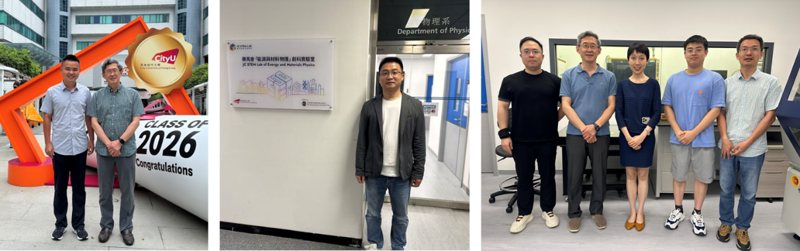

<!--more-->

Dr. Yaohui QU from Jiangxi Normal University conducted a collaborative study from March 2026 to February 2027 centered on designing MOF-derived mesoporous TiO2/carbon composite nanosheets for sodium-ion batteries. Utilizing advanced characterization platforms and electrochemical testing, Dr. Qu conducted in-depth research on the structural evolution and sodium ion insertion/extraction mechanisms. The fellowship culminated in systematic data analysis and the establishment of a follow-up cooperation mechanism between the institutions.

