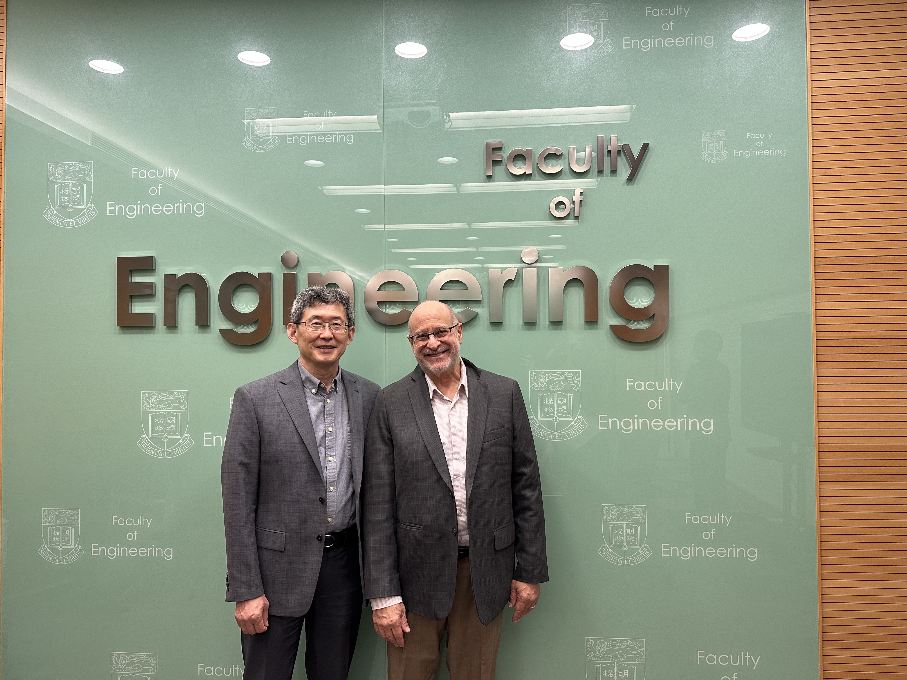

<!--more-->

Prof. Ren also visited Prof. David Srolovitz at The University of Hong Kong (HKU), a globally recognized expert in computational and theoretical materials science. Their discussions centered on integrating AI-driven methods and multiscale computational modeling—such as density functional theory (DFT), molecular dynamics (MD), and phase-field simulations—with experimental research to gain a deeper understanding of structure–property relationships in complex energy materials. By coupling predictive simulations and machine-learning algorithms with advanced physical characterization, including synchrotron and neutron scattering, the collaboration aims to establish closed-loop design–synthesis–characterization frameworks for rapid screening of functional compositions and accelerated optimization of material performance.

Prof. Ren visited Prof. David Srolovitz at The University of Hong Kong (HKU), a globally recognized expert in computational and theoretical materials science. Their discussions centered on integrating AI-driven approaches with experimental research to better understand structure–property relationships in complex energy materials. This collaborative direction aligns with the JC STEM Lab's strategic focus on combining materials physics with data science to accelerate innovation in energy materials research.
