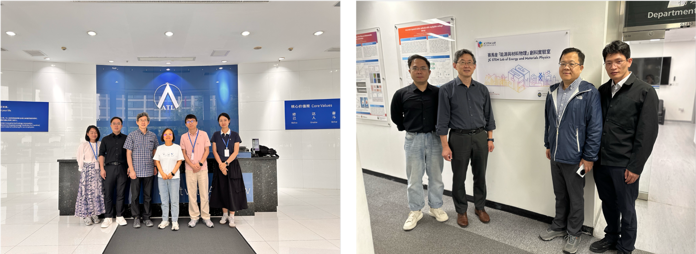

<!--more-->

To strengthen industry–academia collaboration and advance technology translation, Prof. Yang Ren conducted a technical visit to Amperex Technology Limited (ATL) for in-depth discussions on next-generation lithium-ion battery technologies. The exchange focused on how advanced battery materials and cell designs can support emerging application scenarios associated with the low-altitude economy, including electric aerial vehicles and related energy-storage systems. Key topics included high-energy-density cell architectures, safety optimization strategies, and pathways toward pilot-scale manufacturing.

