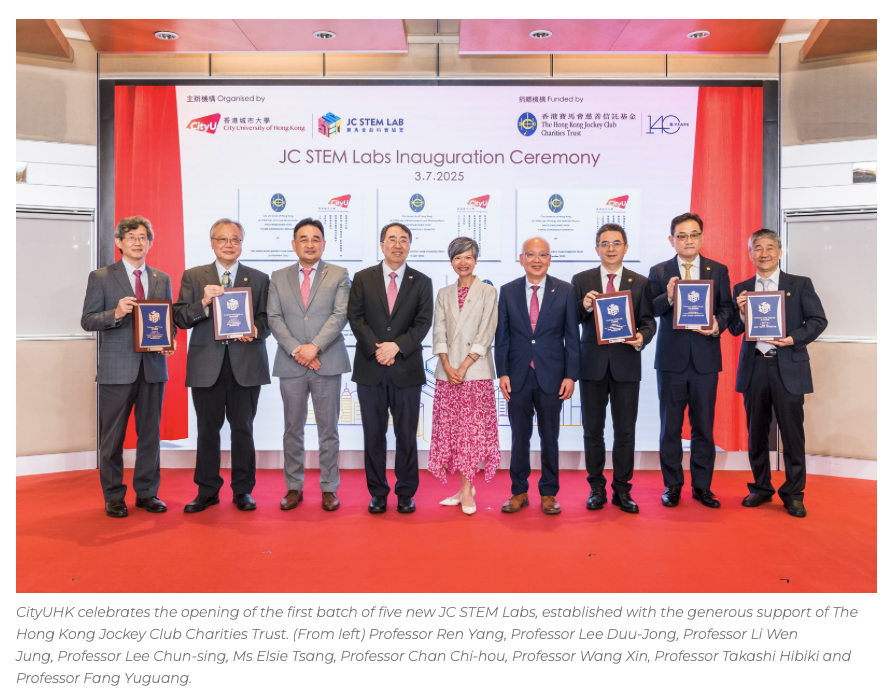
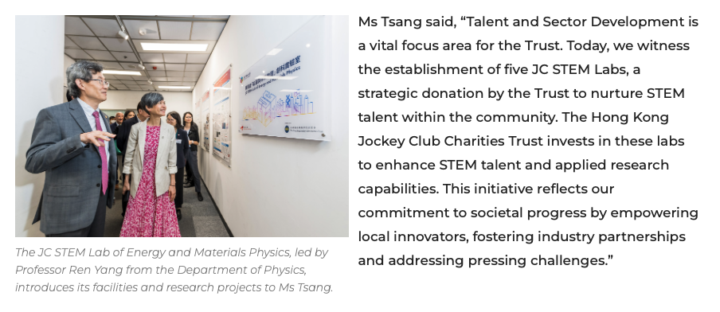
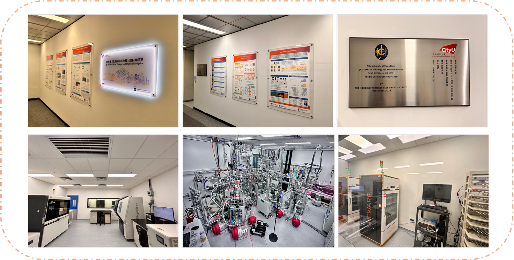
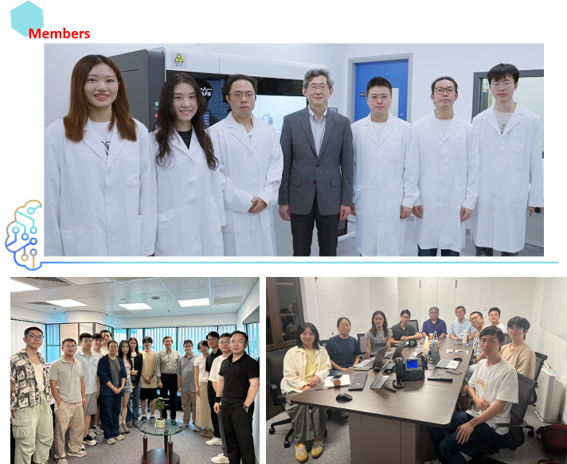

<!--more-->

The JC STEM Lab of Energy and Materials Physics, led by Professor Yang Ren, was officially launched during the inaugural ceremony for the first group of JC STEM Labs supported by The Hong Kong Jockey Club Charities Trust on the 3rd July 2025. The event brought together senior university leaders and partners to celebrate the Lab's establishment and to highlight its mission in advancing interdisciplinary research and nurturing local STEM talent. The successful start-up of the Lab marks a key milestone toward strengthening Hong Kong's research capacity in energy and materials physics and promoting sustained collaboration between academic, industry, and the broader scientific community.

Prof. Ren received HKD 9.35 million from the Hong Kong Jockey Club to establish the JC STEM Lab of Energy and Materials Physics, which has now been fully renovated and is in normal operation. The laboratory provides an advanced R&D platform that bridges fundamental science, cutting-edge technology, and practical production. Key facilities include "Quantum Beast" – QuARPES, X-ray Absorption Fine Structure (XAFS) system, high-resolution X-ray diffraction (XRD) instruments, comprehensive battery testing systems, and a pouch-cell pilot production line. The Lab serves as a vibrant training platform for young researchers, currently comprising 11 post-graduate students (including 3 Hong Kong permanent residents), 10 postdoctoral fellows, 5 visiting scholars, and 4 undergraduates. The Lab was officially opened at a ceremony jointly organized by the Jockey Club and City University of Hong Kong on 3 July 2025.
