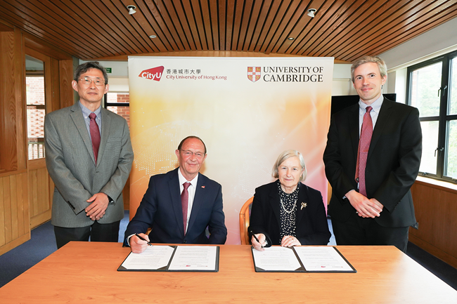
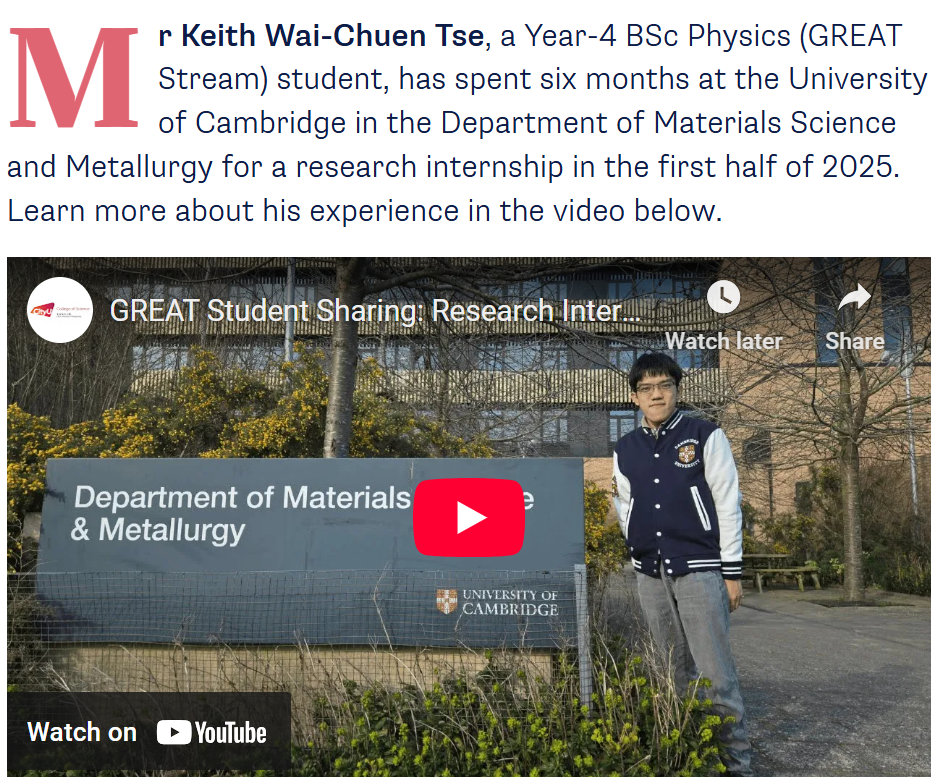

<!--more-->

Prof. Ren has initialized and established global academic and research collaborations between the Department of Physics (CityUHK) and the Department of Materials Science and Metallurgy (the University of Cambridge), and signed a Memorandum of Understanding (MoU) at Cambridge. This formal collaboration strengthens global research linkage and enables extended overseas research training for local students, contributing to high-level talent development for Hong Kong and fostering long-term international cooperation in materials physics.

Prof. Ren has initialized and established global academic and research collaborations between the Department of Physics at City University of Hong Kong (CityUHK) and the Department of Materials Science and Metallurgy at the University of Cambridge, and signed a Memorandum of Understanding (MoU) at Cambridge. This collaboration lays the groundwork for joint research activities, student exchanges, and scholarly exchanges between the two prestigious institutions in materials science and physics research.
